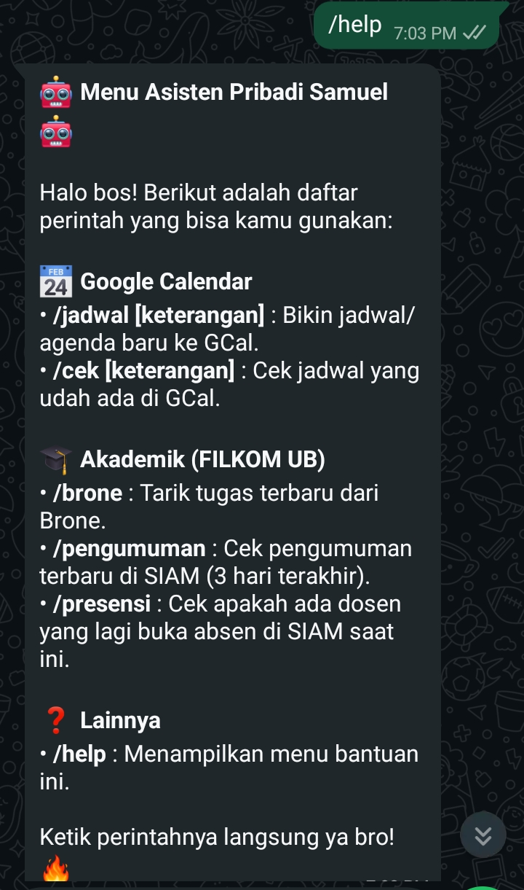
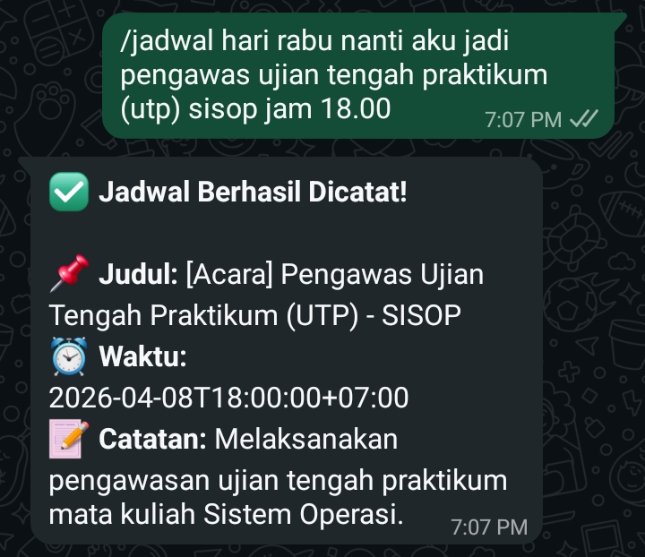
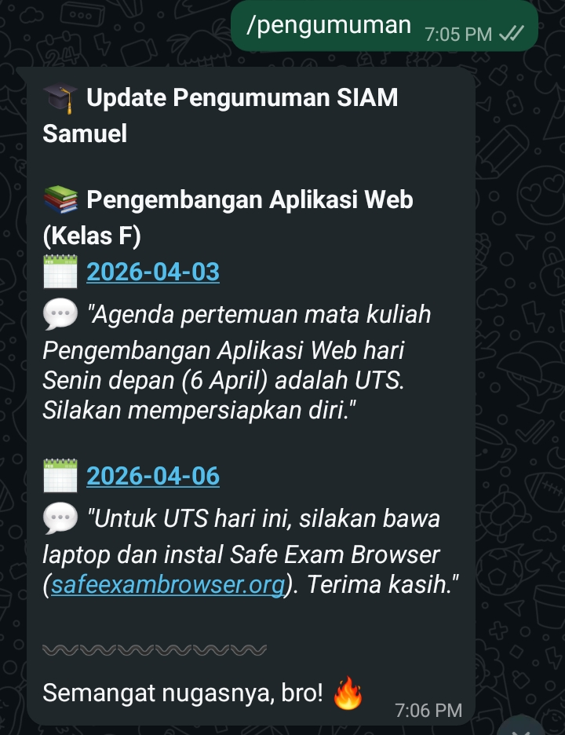
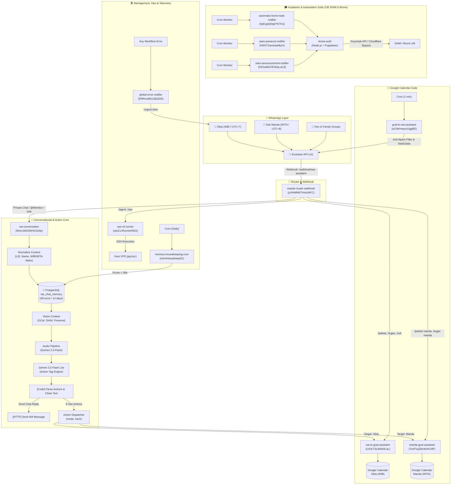

# ⚡ n8n Personal Assistant & Academic Co-Pilot

[](https://n8n.io)
[](https://www.postgresql.org)
[](https://github.com/EvolutionAPI/evolution-api)
[](https://ai.google.dev)
[](https://www.docker.com)
[_%26_WITA_(UTC%2B8)-blue)](#-multi-timezone-synchronization)

An enterprise-grade, multi-workflow personal automation system built on **n8n**, **Docker**, **PostgreSQL**, **Evolution API (WhatsApp)**, and **Google Gemini 3.5 Flash Lite / 2.5 Flash**.

What began as an email notifier has evolved into an autonomous personal assistant for daily agendas, multi-user calendar scheduling, university academic monitoring (Universitas Brawijaya SIAM & Brone LMS), voice-note understanding, multimodal vision, bidirectional partner messaging, and remote VPS administration.

---

## 📸 Showcase & User Experience

### 1. Interactive WhatsApp Interface
| 🤖 Natural Language & Actions | 📅 Calendar Confirmation Card | 📚 Academic & SIAM Notifier |
| :---: | :---: | :---: |
|  |  |  |
| *Conversational multi-turn memory & natural task creation* | *Instant GCal booking & automated WhatsApp confirmation* | *Automated SIAM class announcements & attendance alerts* |

---

## 🏛️ System Architecture



---

## 🌟 Key Capabilities

### 1. 🎯 Natural Language Action Triggering
The assistant doesn't just chat—it **takes direct action**. Users can talk conversationally or reference past messages, and the assistant will automatically parse parameters, resolve dates, and trigger the appropriate sub-workflow to create the event in Google Calendar:
* **Example:** `@n8n buatin tugas yang aku sebut tadi (di chat sebelumnya ada tugas ppt) deadlinenya lusa jam 23.59`
  1. AI inspects PostgreSQL conversation memory (`wa_chat_memory`), finds *PPT Pengabdian* and *PPT Scope*.
  2. Resolves relative time: "lusa jam 23.59" $\rightarrow$ `Kamis, 22 Oktober 2026 jam 23.59 WIB`.
  3. Emits discrete action tags:
     ```text
     <<<ACTION:TUGAS|okta|PPT Pengabdian deadline Kamis 22 Oktober 2026 jam 23.59>>>
     <<<ACTION:TUGAS|okta|PPT Scope deadline Kamis 22 Oktober 2026 jam 23.59>>>
     ```
  4. Automatically dispatches each item into `wa-to-gcal-assistant` (`mode: each`).
  5. Both tasks are created in Google Calendar and official confirmation cards are sent to the WhatsApp chat room.

### 2. 👥 Dual-User & Multi-Timezone Architecture
* **Okta:** Localized to **WIB (Asia/Jakarta, UTC+7)**. Controls personal agendas, university courses, and developer tools.
* **Kak Manda:** Localized to **WITA (Asia/Makassar, UTC+8)**. Manages pharmacy school coursework, clinical agendas, and personal reminders.
* **Cross-Calendar Scheduling:** Okta can request tasks/agendas for Kak Manda (`target: manda`), and Kak Manda can request tasks/agendas for Okta (`target: okta`).

### 3. 🎙️ Multimodal Voice Notes & Vision Injection
* **Voice Notes (VN):** Outbound audio messages in private chats or groups are converted to Base64, processed by `gemini-2.5-flash` with native audio understanding, and answered immediately.
* **Vision Queries:** When users ask about schedules, SIAM announcements, or attendance, the system queries live data upstream and injects it as `visionContext` into Gemini 3.5 Flash Lite, preventing hallucinations.

### 4. 💌 Bidirectional Note Relay (Titip Pesan)
* Okta can say: *"Titip pesan ke Manda: jangan lupa minum vitamin ya"* $\rightarrow$ Bot automatically forwards the formatted note directly to Kak Manda's WhatsApp.
* Kak Manda can say: *"Titip pesan ke Okta: nanti malam kabarin ya"* $\rightarrow$ Bot forwards it directly to Okta.

### 5. 🤖 Autonomous VPS Agent (`/agent` & `/vps`)
* Send `/agent <prompt>` or `/vps <command>` on WhatsApp to execute server maintenance, inspect Docker containers, check RAM/disk usage, or trigger script automation safely via `vps-cli-runner`.

### 6. 🧠 Chronological PostgreSQL Memory (40 Turns / 14 Days)
* Chat history is siloed strictly by `room_jid` (private chat Okta, private chat Kak Manda, group chats are completely separated for privacy).
* Queries the latest **40 messages** across **14 days**, reversed chronologically (`oldest -> newest`) with intelligent timestamps (`[10.19]` for today, `[18 Okt, 15.30]` for prior dates) to preserve context.
* Background cron (`memory-housekeeping-cron`) prunes records older than 30 days.

### 7. 🛡️ GCal Anti-Spam & Deduplication
* Prevents Google Calendar API overlap spam using strict minute checks (`diffMinutes === targetMinute`) and `$getWorkflowStaticData('global')` state deduplication across 15m, 30m, 60m, 12h, and 36h windows.

### 8. 👥 Whitelisted Group Chat Access for VPS Agent
* Run `/agent <prompt>` or `/vps <command>` directly inside whitelisted WhatsApp groups (e.g. `$env.WA_GROUP_DEV`).
* Automatically strips bot mention tags (`@171619058196619 /agent ...`), verifies that the sender is Okta, executes on host VPS securely, and responds directly in the originating group.

### 9. ⚡ One-Click & Conversational Presensi UB
* Instant Attendance: When UB SIAM attendance notifications arrive, reply with a single word (`hadir`, `absen`, `hadir daring`) without any slash prefix to complete attendance in 1 second.
* Conversational: Chat with `@n8n tolong absenkan kelas sekarang dong` to trigger automatic SIAM attendance.

### 10. 📝 Personal & Cross-Check User Notes (`user_notes`)
* Store persistent notes, debts, to-dos, and quick ideas in PostgreSQL `user_notes`.
* Both Okta and Kak Manda have isolated active notes, with bidirectional cross-checking (`/notes manda`, `/notes okta`, `@n8n catatanku apa aja`).
* Mark done with `/catat done <ID>` or `@n8n tandai catatan 1 selesai`.

### 11. 📸 Multimodal Image OCR & Vision Q&A
* Powered by `gemini-2.5-flash` with native image understanding.
* Send an image or quote reply an existing photo on WhatsApp:
  * Lecture Slides: Ask *"bro ini maksud diagramnya gimana?"*
  * Homework / Coding: Ask *"bantu langkah-langkah selesaikan soal ini"*
  * Receipt OCR: Transcribe totals and itemized purchases from shopping receipts.

### 12. 🗓️ Google Calendar Lifecycle Management (`[SELESAI]` / Delete)
* Mark tasks as done: `/done PPT Pengabdian` or `@n8n tugas PPT pengabdian udah selesai nih` updates Google Calendar event title with `[SELESAI]` and sets event color to green.
* Cancel / delete events: `/hapus-jadwal Meeting Tim` or `@n8n meeting tim tadi di-cancel, tolong hapus` removes the event from Google Calendar.
* Interactive follow-up: Bot asks *"Mau ditandai [SELESAI] di kalender atau langsung dihapus aja bro?"* when intent is ambiguous.

---

## 📦 Complete Workflows Catalog (15 Workflows)

| # | Workflow Name | Workflow ID | Trigger | Description |
|---|---|---|---|---|
| 1 | **master-router-webhook** | `yViHMhfkTHv6uNFC` | Webhook (`/wa-assistant`) | Central webhook router from Evolution API; routes commands, mentions, and private chats |
| 2 | **wa-conversation** | `WmvJdI22Wr5O1k9y` | Sub-workflow | Multimodal conversational assistant, voice note processing, memory retrieval & action trigger engine |
| 3 | **wa-to-gcal-assistant** | `U43zT3sJktIA9LaL` | Sub-workflow / Slash | Creates events & checks Okta's Google Calendar (`GCAL_OKTA_AGENDA`, `GCAL_OKTA_TUGAS`) |
| 4 | **manda-gcal-assistant** | `TcoP1qZ8e4dvKU9F` | Sub-workflow / Slash | Creates events & checks Kak Manda's Google Calendar (`GCAL_MANDA_AGENDA`, `GCAL_MANDA_TUGAS`) |
| 5 | **gcal-to-wa-assistant** | `eCtWrmeyciUgg8f2` | Cron (Every 1 min) | Proactive agenda reminders (15m, 30m, 60m, 12h, 36h) with stateful anti-spam deduplication |
| 6 | **automatic-email-notifier-workflow** | `GNtnCWmLXbMF5iON` | IMAP / Email | Summarizes urgent incoming emails with Gemini and alerts WhatsApp |
| 7 | **automatic-brone-task-notifier** | `hpEygIQDgIYN7IVy` | Cron | Scrapes Brone LMS course tasks via `brone-auth` and pushes assignment notifications |
| 8 | **siam-announcement-notifier** | `OOvaMsCEOkqLuIL8` | Cron | Fetches university announcements from UB SIAM API and notifies students |
| 9 | **siam-presensi-notifier** | `H5lVT2ani2aaNkyV` | Cron | Monitors daily lecture attendance slots on UB SIAM and reminds to check in |
| 10 | **vps-cli-runner** | `vpsCLIRunner0001` | Sub-workflow | Executes shell commands & Codex tasks securely on the VPS host |
| 11 | **memory-housekeeping-cron** | `memHousekeep01` | Cron (Daily at 03:00) | Prunes conversation memory in `wa_chat_memory` older than 30 days |
| 12 | **global-error-notifier** | `ERRnotif01UB2026` | Error Trigger | Catch-all error workflow sending structured crash alerts to WhatsApp |
| 13 | **personal-porto-chatbot** | `vunnMOdxPHnUhABI` | Webhook | Portfolio interactive Q&A assistant |
| 14 | **personal-porto-generate-article** | `wmv1KZ32E8OnHmYc` | Webhook | Content generation workflow for tech portfolio articles |
| 15 | **My workflow 4** | `M8b8EyT5nJkzsGPQ` | Manual / Sub-workflow | Custom utility and testing pipeline |

---

## 💬 WhatsApp Command Reference

### Google Calendar Commands
| Command | Target | Description |
|---|---|---|
| `/cek` | Okta / Manda | Check schedule for today |
| `/besok` | Okta / Manda | Check schedule for tomorrow |
| `/agenda` | Okta / Manda | View upcoming agenda for the next 7 days |
| `/tugas` | Okta / Manda | View pending academic deadlines and tasks |
| `/uas` | Okta / Manda | Check exam schedule |
| `/jadwal <detail>` | Okta / Manda | Create a calendar event (e.g. `/jadwal Meeting Tim besok jam 14.00`) |
| `/tugas <detail>` | Okta / Manda | Create a task deadline (e.g. `/tugas Laporan PAPB Jumat jam 23.59`) |
| `/done <judul>` | Okta / Manda | Mark task as completed (`[SELESAI]`) in Google Calendar |
| `/selesai <judul>` | Okta / Manda | Alias for `/done` |
| `/hapus-jadwal <judul>` | Okta / Manda | Delete event from Google Calendar |

### Notes & To-Do System (`/catat` & `/notes`)
| Command / Input | Target | Description |
|---|---|---|
| `/catat <isi>` | Self | Save a note in PostgreSQL `user_notes` |
| `/notes` or `/catatan` | Self | List active notes for current user |
| `/catatan manda` | Okta | View active notes of Kak Manda |
| `/catatan okta` | Manda | View active notes of Okta |
| `/catat done <id>` | Self | Mark note as completed |
| `"@n8n catat kalau belum bayar kas 50k"` | Conversational | Conversational note saving |
| `"@n8n catatanku apa aja?"` | Conversational | Conversational note listing |
| `"@n8n tandai catatan 1 selesai"` | Conversational | Conversational note completion |

### Presensi UB Commands
| Command / Input | Description |
|---|---|
| `hadir` / `absen` | One-word instant attendance when notification arrives |
| `/presensi hadir` | Manual attendance for active lecture |
| `/presensi hadir daring` | Online attendance submission |
| `"@n8n tolong absenkan kelas sekarang"` | Conversational attendance trigger |

### Multimodal & Conversational Actions
| Natural Input | Target | Behavior |
|---|---|---|
| `"@n8n buatin tugas PPT deadlinenya lusa jam 23.59"` | Okta / Manda | Auto-extracts tasks, triggers `wa-to-gcal-assistant`, books in Google Calendar |
| `"@n8n tugas PPT pengabdian udah selesai nih"` | Okta / Manda | Finds event in GCal, marks as `[SELESAI]` or prompts to delete |
| `"@n8n meeting tim tadi di-cancel tolong hapus"` | Okta / Manda | Deletes meeting event from Google Calendar |
| `"titip pesan ke manda: semangat ya praktikumnya"` | Relay | Relays formatted card to Kak Manda's WhatsApp |
| `[Photo / Image]` + *"ini maksudnya apa bro?"* | Vision OCR | Transcribes text, solves problems, or explains diagram via Gemini 2.5 Flash |
| `[Voice Note]` | Conversational | Transcribes audio via Gemini 2.5 Flash, answers naturally or executes actions |

### VPS & Developer Commands
| Command | Access | Description |
|---|---|---|
| `/agent <prompt>` | Okta Only (Private / Group) | Autonomous server agent execution |
| `/vps <command>` | Okta Only (Private / Group) | Direct bash command execution (e.g. `/vps docker ps`, `/vps df -h`) |
| `/stiker` or `/sticker` | General | Converts media image into WhatsApp sticker |

---

## ⚙️ Environment Variables Reference

Copy `.env.example` to `.env` and fill in your credentials:

```bash
cp .env.example .env
```

| Variable | Description |
|---|---|
| `DB_USER`, `DB_PASSWORD`, `DB_NAME` | PostgreSQL credentials for `notifier_db` (`n8n_db` and `evo_db`) |
| `N8N_ENCRYPTION_KEY` | 32-character random string for encrypting n8n credentials |
| `N8N_USER`, `N8N_PASSWORD` | Basic Auth login for n8n web UI |
| `N8N_PORT`, `EVO_PORT` | Port mappings (Default: n8n `5679->5678`, Evolution `9001->8080`) |
| `WA_API_TOKEN` | Evolution API Global API Token for authenticating HTTP requests |
| `GEMINI_API_KEY` | Google Gemini API key(s) (comma-separated for auto-rotation) |
| `MY_WA_NUMBER` | Okta's WhatsApp number in international format (`628xxxxxxxxx`) |
| `MANDA_WA_NUMBER` | Kak Manda's WhatsApp number (`628xxxxxxxxx`) |
| `WA_GROUP_DEV`, `WA_GROUP_NOTIF` | Whitelisted WhatsApp group JIDs (`xxxx@g.us`) |
| `GCAL_OKTA_AGENDA`, `GCAL_OKTA_TUGAS` | Google Calendar IDs for Okta's events and deadlines |
| `GCAL_MANDA_AGENDA`, `GCAL_MANDA_TUGAS`| Google Calendar IDs for Kak Manda's events and deadlines |
| `BRONE_USERNAME`, `BRONE_PASSWORD` | University SIAM/Brone credentials used by `brone-auth` |

---

## 🚀 Deployment & Workflow Synchronization

### 1. Launch with Docker Compose
```bash
docker compose up -d
```

### 2. Bidirectional Workflow Synchronization
To pull all 15 workflows from the remote VPS n8n container to the local repository:
```bash
./scripts/sync-workflows.sh
```
* Exports workflows cleanly.
* Formats JSON with pretty-indentation.
* Scans automatically for leaked credentials or API keys.

### 3. Deploy Workflows to Remote VPS
```bash
python3 scripts/deploy_workflows.py
```

---

## 🔒 Security & Privacy Audit
* All workflow JSON files are strictly sanitized before commit: **0 hardcoded credentials, API keys, passwords, or personal phone numbers**.
* All sensitive credentials and endpoints utilize `$env.*` expressions.
* Automated security scanning script (`scripts/sanitize_credentials_and_privacy.py`) runs in the CI/CD pipeline to block accidental secret leaks.

---

## 📚 Detailed Documentation Hub

Detailed architecture designs, technical postmortems, catalogs, and strategic roadmaps are documented under the [`docs/`](docs/) directory:

* 🚀 **[Strategic Roadmap & Feature Expansion Ideas](docs/roadmap.md):** Next-generation roadmap covering RAG memory (`pgvector`), morning voice briefings, receipt expense tracking, and auto-presensi.
* 🧠 **[WhatsApp Chatbot Evolution Plan](docs/evolution-plan.md):** Dual-model architecture (Gemini 3.5 Flash Lite + 2.5 Flash), audio understanding, and multi-timezone routing.
* 📦 **[Complete Workflow Catalog](docs/workflow-catalog.md):** Deep breakdown of all 15 active workflows, IDs, triggers, and execution flows.
* 🛠️ **[Workflow Improvement & Bugfix Report](docs/improvement-report.md):** Technical postmortem of GCal anti-spam deduplication, system-wide WIB/WITA synchronization, and Codex runner diagnostics.
* 🔍 **[Incident Postmortem & Memory Audit](issues/issue.md):** Chrome/Puppeteer `/tmp` disk footprint analysis and containment safeguards.

---

## 📄 License
MIT License. Built with ❤️ for personal productivity and academic automation.
