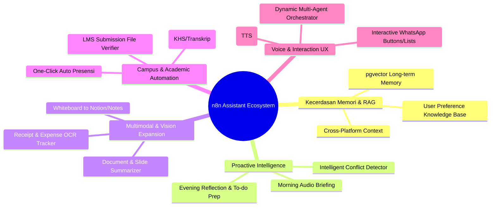

# 🚀 Strategic Development Roadmap & Expansion Ideas: n8n Personal Assistant

Dokumen ini merangkum analisis arsitektur, peluang inovasi, dan roadmap pengembangan fitur masa depan untuk ekosistem **n8n Personal Assistant**.

---

## 🧭 Kategori Inovasi & Feature Roadmap

---

## 💡 Ide-Ide Pengembangan Prioritas Tinggi

### 1. 🧠 Long-Term Semantic Memory (RAG via `pgvector`)
* **Masalah Saat Ini:** Memori `wa_chat_memory` mengambil 40 percakapan dalam 14 hari terakhir. Informasi permanen penting (seperti preferensi makanan, nomor rekening, kontak dosen, janji masa depan) bisa terlupakan setelah lewat dari window waktu.
* **Solusi Inovasi:**
  * Aktifkan ekstensi `pgvector` di container PostgreSQL `notifier_db` yang sudah ada.
  * Buat tabel `user_knowledge_facts` yang menyimpan fakta permanen dalam bentuk vector embeddings (menggunakan model text-embedding Google).
  * **Contoh Interaksi:**
    > **Okta:** *"Bot, catat nomor rekening BCA Manda 1234567890 ya"*  
    > **2 Bulan Kemudian:** *"Bro nomor rek Manda berapa ya?"*  
    > **Bot:** Langsung mencari via semantic similarity dan menjawab dengan tepat!

---

### 2. 🌅 Proactive Morning Audio Brief & Evening Recap
* **Konsep:** Ubah asisten dari yang pasif menunggu chat menjadi **proaktif melayani di waktu yang tepat**.
* **Fitur:**
  1. **Morning Brief (Pukul 07.00 WIB):**
     * Menggabungkan jadwal Google Calendar hari ini (kuliah & agenda), tugas yang deadline hari ini, prakiraan cuaca Malang/Banjarmasin, dan pengumuman baru dari SIAM.
     * Menggunakan TTS (Text-to-Speech Google / ElevenLabs) untuk mengirimkan ringkasan berupa **Voice Note WhatsApp** berdurasi 45–60 detik, sehingga Okta/Kak Manda bisa mendengarkannya sambil bersiap di pagi hari.
  2. **Evening Recap (Pukul 21.00 WIB):**
     * Evaluasi tugas hari ini, mengingatkan tugas besok, dan menanyakan apakah ada agenda yang perlu dijadwalkan untuk esok hari.

---

### 3. 🧾 Smart Receipt & Expense Tracker (Vision OCR)
* **Konsep:** Pencatatan keuangan harian tanpa aplikasi ribet, cukup kirim foto struk belanja di WhatsApp.
* **Alur:**
  1. Pengguna memotret struk belanjaan / transfer m-banking ke chat bot.
  2. Vision Model membaca total nominal, tanggal, nama merchant, dan item pembelian.
  3. Mengklasifikasikan kategori (Makan, Groceries, Bensin, Hiburan, dll.).
  4. Menyimpan otomatis ke tabel `finance_tracker` di PostgreSQL atau Google Sheets.
  5. Perintah mingguan: `/pengeluaran` $\rightarrow$ *"Minggu ini total pengeluaranmu Rp 450.000, paling banyak di Kategori: Makanan & Kopi."*

---

### 4. ⚡ One-Click Auto-Presensi WhatsApp
* **Konsep:** Integrasi lanjutan dengan service `brone-auth` yang sudah memiliki endpoint `/submit-siam-presensi`.
* **Alur:**
  1. Node `siam-presensi-notifier` mendeteksi bahwa jadwal presensi matkul (misal *PAPB*) telah dibuka oleh dosen.
  2. Bot mengirim WhatsApp:
     > *"🔔 **Presensi Perkuliahan Dibuka!**  
     > Matkul: Pengembangan Aplikasi Perangkat Bergerak  
     > Balas **'absen'** atau klik konfirmasi untuk presensi otomatis sekarang!"*
  3. Saat Okta membalas *"absen"*, n8n langsung memicu `POST http://brone-auth:3000/submit-siam-presensi` dengan kode materi dan absensi 'H'.
  4. Bot mengirim bukti sukses: *"✅ Kamu berhasil tercatat Hadir di SIAM UB!"*

---

### 5. 🛡️ Intelligent Calendar Conflict Detector & Auto-Rescheduler
* **Masalah:** Saat menambah agenda meeting baru, sering kali berbenturan dengan jadwal kuliah atau agenda yang sudah ada tanpa disadari.
* **Solusi Inovasi:**
  * Di sub-workflow pembuatan jadwal, sebelum event di-insert ke Google Calendar, lakukan query `getAll` pada rentang waktu `[start, end]`.
  * Jika ditemukan event lain:
    > *"⚠️ **Jadwal Bentrok!**  
    > Agenda 'Meeting Tim' jam 14.00 tabrakan dengan kuliah 'Jaringan Nirkabel' (13.30 - 15.10 WIB).  
    > Mau gue geser otomatis ke jam 15.30 WIB?"*
  * Jika disetujui, bot langsung menjadwalkan di slot kosong pertama yang tersedia.

---

### 6. 🎙️ AI Voice Note Reply (TTS Multi-Modal Dua Arah)
* **Konsep:** Saat ini bot sudah bisa mendengar dan memahami pesan suara (Voice Note) dari pengguna menggunakan Gemini 2.5 Flash, namun bot membalasnya dengan teks.
* **Fitur Lanjutan:**
  * Tambahkan opsi agar bot membalas pesan suara dengan **pesan suara juga** (Voice-to-Voice WhatsApp).
  * Menghasilkan audio OGG Opus yang dikirimkan via Evolution API `/message/sendWhatsAppAudio` dengan flag `ptt: true` (sehingga tampil sebagai voice note hijau resmi).

---

### 7. 📊 Grade & Academic Milestone Watcher (KHS/Transkrip UB)
* Menjelang akhir semester, dosen menginput nilai di SIAM UB secara berkala.
* Tambahkan endpoint di `brone-auth` untuk scraping berkala tabel KHS.
* Saat nilai matkul baru keluar (misal: *MLOps: Nilai A*), bot langsung mengirimkan notifikasi perayaan gembira ke WhatsApp!

---

## 📈 Roadmap Timeline & Status Pelaksanaan

| Phase | Fokus Utama | Deliverables | Status |
|---|---|---|---|
| **Phase 1** | *Immediate Polish & Core Lifecycle* | One-click presensi (`"hadir"`, `"absen"`), sistem catatan (`/catat`, `/notes`), lifecycle agenda GCal (`[SELESAI]`, hapus) | **SELESAI (Aktif)** ✅ |
| **Phase 2** | *Audio & Proactive Briefing* | Proactive Morning Audio Brief VN jam 07.00 WIB (`edge-tts` ArdiNeural), Multimodal Vision OCR | **SELESAI (Aktif)** ✅ |
| **Phase 3** | *Smart Expense & Group Access* | Smart Expense Tracker (`user_expenses` table + struk OCR), Akses Agent dari Group Chat (`@n8n`, `/agent`) | **SELESAI (Aktif)** ✅ |
| **Phase 4** | *RAG & Long-Term Memory* | Integrasi `pgvector` di PostgreSQL untuk fakta permanen lintas bulan, Academic KHS Grade Watcher | *Next Sprint* 🚀 |
