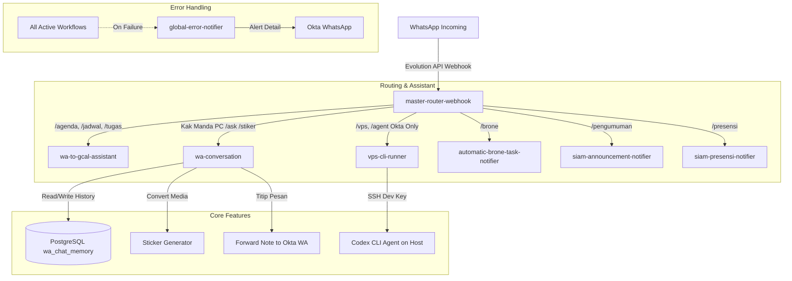

# 📖 Katalog Fitur Ekosistem n8n Personal Assistant (Versi Update)

Dokumentasi ini merangkum seluruh fitur, alur kerja, dan integrasi dari **14 workflow aktif** pada sistem **n8n Personal Assistant** yang berjalan di VPS `pg-bcc`.

---

## 🧭 Peta Arsitektur Ekosistem

---

## 📱 1. Fitur Interaksi WhatsApp & Chatbot

### A. WhatsApp Router (`master-router-webhook` - `yViHMhfkTHv6uNFC`)
Pusat kontrol dan filter pesan masuk WhatsApp dari Evolution API:
- **Filtering Cerdas:** Mengabaikan pesan dari bot sendiri (`fromMe: true`) dan pesan tanpa konten relevan.
- **23 Aturan Routing Dinamis:** Mendeteksi command, prefix, mention bot di grup, nomor pengirim, whitelist grup (`ALLOWED_AGENT_GROUPS`), presensi one-word, notes, dan media.
- **Multi-Room Awareness:** Mengenali apakah pesan berasal dari Private Chat Okta, Private Chat Kak Manda, atau Group Dev/Shared.

### B. AI Conversation & Memory (`wa-conversation` - `WmvJdI22Wr5O1k9y`)
Chatbot percakapan multimodal berbasis Google Gemini dengan memori kronologis dan action trigger:
- **Database Chat Memory:** Tersimpan di PostgreSQL (`n8n_db.public.wa_chat_memory`). Mengingat **40 percakapan terakhir** dalam **14 hari** terakhir per room chat (kronologis `oldest -> newest`).
- **Multimodal Vision & Voice Notes:**
  - **Voice Notes (VN):** Audio ditranskripsi dan dipahami native oleh `gemini-2.5-flash`.
  - **Image Understanding & OCR:** Membaca teks slide materi, lembar soal tugas, struk belanja, dan diagram arsitektur via Gemini Vision.
- **Sistem Catatan Pribadi & Dua Arah:** Terhubung ke PostgreSQL `user_notes` untuk `/catat`, `/notes`, dan cross-check antara Okta dan Kak Manda.
- **Action Trigger Engine:** Mengubah niat percakapan menjadi aksi nyata di Google Calendar (`TUGAS`, `JADWAL`, `DONE`, `DELETE`), Catatan (`NOTE_ADD`, `NOTE_DONE`), dan Presensi UB (`PRESENSI`).
- **Persona Dinamis ("Perwakilan Okta"):**
  - **Khusus Kak Manda:** Bot memposisikan diri sebagai perwakilan Okta yang ramah, sopan, panggil *"Kak Manda"*, hangat, to the point, dan tidak alay.
  - **Okta & Group:** Bot menjadi co-pilot teknis yang tanggap dan ringkas.
- **Fitur "Titip Pesan" Otomatis:** Jika Kak Manda menitipkan pesan, bot otomatis meneruskannya ke WhatsApp pribadi Okta (dan sebaliknya).
- **Sticker Generator (`/stiker` / `/sticker`):**
  - Mengonversi foto, video pendek, atau GIF langsung menjadi stiker WhatsApp animasi atau statis via Evolution API.

### C. VPS CLI Agent Runner (`vps-cli-runner` - `vpsCLIRunner0001`)
Menjalankan agen AI langsung di host VPS via WhatsApp:
- **Perintah:** `/vps <instruksi>` atau `/agent <instruksi>`.
- **Akses Grup Ter-Whitelist:** Dapat dipicu dari Private Chat maupun Group Chat yang terdaftar di `ALLOWED_AGENT_GROUPS` / `WA_GROUP_DEV`.
- **Akses Eksklusif (Zero-Trust):** Hanya dapat dipicu oleh pengirim terverifikasi Okta (`$env.MY_WA_NUMBER`). Tag mention bot otomatis dibersihkan.
- **Immediate Acknowledgment:** Mengirim konfirmasi seketika bahwa tugas sedang diproses di VPS.
- **Eksekusi Aman:** Terhubung via SSH ed25519 internal dengan command blacklist (`rm -rf /`, `mkfs`, `shutdown`, dll.) dan timeout 120 detik.
- **Hasil Terstruktur:** Mengembalikan rangkuman hasil eksekusi terminal/agen langsung ke WhatsApp.

---

## 📅 2. Fitur Kalender & Jadwal Kuliah

### A. Okta Google Calendar Assistant (`wa-to-gcal-assistant` - `U43zT3sJktIA9LaL`)
- **Query Bahasa Alami:** Cek jadwal hari ini, besok, minggu ini, ujian (UAS), tugas, dan agenda kuliah.
- **Lifecycle Management:** Mendukung `/done <judul>`, `/selesai <judul>` (menandai `[SELESAI]` dan ubah warna), serta `/hapus-jadwal <judul>` (menghapus event dari kalender).
- **Fallback Jadwal Kosong:** Memberikan pesan ramah dan informatif jika tidak ada agenda pada tanggal yang diminta.
- **Validasi Command:** Mendeteksi jika parameter tanggal/perintah kurang lengkap dan memberikan petunjuk format yang benar.

### B. Manda Google Calendar Assistant (`manda-gcal-assistant` - `TcoP1qZ8e4dvKU9F`)
- Khusus terintegrasi dengan kalender agenda, kuliah, dan tugas Kak Manda.
- Dilengkapi lifecycle `/done`, `/selesai`, `/hapus-jadwal`, fallback jadwal kosong, dan validasi prompt yang sama handalnya.

### C. Pengingat Otomatis Terjadwal (`gcal-to-wa-assistant` - `eCtWrmeyciUgg8f2`)
- Cron harian yang otomatis membaca agenda dan jadwal kuliah pagi hari.
- Mengirimkan ringkasan briefing harian ke WhatsApp Okta dan grup kuliah.

---

## 🎓 3. Notifier Akademik & Kampus

### A. SIAM UB Pengumuman (`siam-announcement-notifier` - `OOvaMsCEOkqLuIL8`)
- Memantau pengumuman terbaru di portal akademik SIAM UB.
- Mengirim notifikasi judul dan isi pengumuman begitu ada rilis baru.

### B. SIAM UB Presensi (`siam-presensi-notifier` - `H5lVT2ani2aaNkyV`)
- Memeriksa jadwal kuliah hari berjalan dan status presensi online.
- Mengirim pengingat jika sesi presensi telah dibuka.

### C. Brone LMS Notifier (`automatic-brone-task-notifier` - `hpEygIQDgIYN7IVy`)
- Terintegrasi dengan container `notifier_brone_auth` (Puppeteer browser) untuk bypass login SSO.
- Melakukan scraping berkala terhadap daftar tugas dan kuis di platform Brone UB.
- Memberikan reminder tenggat waktu tugas yang mendekati deadline.

### D. Email Kampus & Umum (`automatic-email-notifier-workflow` - `GNtnCWmLXbMF5iON`)
- IMAP listener yang memantau kotak masuk email penting.
- Memfilter email prioritas dan mengirimkan rangkuman isi email ke WhatsApp.

---

## 🛡️ 4. Monitoring & Error Reliability

### Global Error Notifier (`global-error-notifier` - `ERRnotif01UB2026`)
- Ditetapkan sebagai **Default Error Workflow** di seluruh n8n (`N8N_DEFAULT_ERROR_WORKFLOW`).
- Jika ada workflow yang crash, error API eksternal, atau timeout:
  - Otomatis menangkap nama workflow, ID, node yang gagal, dan stack trace error.
  - Mengirim alert instan langsung ke nomor WhatsApp Okta lengkap dengan link direct execution untuk debugging cepat.

---

## 🌐 5. Layanan Eksternal & Portfolio

1. **Portfolio AI Chatbot (`personal-porto-chatbot` - `vunnMOdxPHnUhABI`):**
   - Webhook API publik (`/webhook/portfolio-chat`) melayani percakapan interaktif pengunjung di website portfolio Okta.
2. **Portfolio Article Generator (`personal-porto-generate-article` - `wmv1KZ32E8OnHmYc`):**
   - Webhook API terautentikasi (`/webhook/portfolio-article-generate`) untuk men-generate artikel teknis baru secara otomatis.
3. **Utility Workflow (`My workflow 4` - `M8b8EyT5nJkzsGPQ`):**
   - Webhook penunjang utilitas umum.
